# Product Requirements Document (PRD) — Production E-Commerce Platform
## Toko Online Terdistribusi dengan Ketersediaan Tinggi & Toleransi Kesalahan (High Availability & Fault-Tolerant Distributed E-Commerce)

- **Dokumen Versi:** 2.0.0 (Production-Grade Architecture)
- **Status:** Approved for Implementation
- **Domain:** Distributed Systems, High Availability, Multi-Protocol Fault Tolerance, Enterprise E-Commerce
- **Target Deployment:** Multi-Node Local Area Network (LAN) & Containerized Orchestration (Docker Compose)
- **Mata Kuliah / Acuan:** Sistem Terdistribusi (IF2228), Teknik Informatika, Universitas Trunojoyo Madura

---

## 1. Executive Summary & Transformasi Sistem

### 1.1 Latar Belakang & Visi Produk
Platform e-commerce modern beroperasi di bawah ekspektasi ketersediaan 24/7/365 dengan volume transaksi yang fluktuatif. Pada momen lonjakan pengunjung (*flash sale*, kampanye diskon, peluncuran produk terbatas), sistem monolitik berbasis server tunggal menghadapi risiko fatal berupa **Single Point of Failure (SPOF)**. Apabila server tunggal mengalami gangguan perangkat keras, kehabisan memori, crash pada kernel, atau terputusnya koneksi fisik, seluruh ekosistem bisnis terhenti seketika (*total operational blackout*). Dampaknya meliputi kerugian finansial langsung (*loss of revenue*), penurunan kepercayaan pelanggan, hingga kerusakan integritas data akibat transaksi yang terputus di tengah eksekusi.

Dokumen ini memformalkan transformasi dari prototipe akademis Sistem Terdistribusi (versi 1.0) menjadi **Aplikasi Web E-Commerce Produksi Nyata (Production-Ready E-Commerce Web Application v2.0)**. Sistem baru ini menggabungkan antarmuka modern responsif (*Modern Web Frontend*) berbasis Next.js App Router dan Tailwind CSS dengan arsitektur backend terdistribusi multi-protokol (RPC, RMI, REST API) berbasis Python 3 yang tangguh, menerapkan topologi **Koordinator–Pengikut (Primary–Backup / Hot-Standby)**, mekanisme deteksi kegagalan **Heartbeat**, **Automatic Failover Promotion**, dan **Client-Side Transparent Failover Routing**.

### 1.2 Matriks Transformasi: Prototipe Akademis vs. Versi Produksi

| Aspek Arsitektural / Fitur | Prototipe Dasar (Versi 1.0) | Sistem E-Commerce Produksi (Versi 2.0) |
| :--- | :--- | :--- |
| **Antarmuka Pengguna (Frontend)** | Server-rendered HTML sederhana menggunakan Flask + Jinja2 satu halaman statis. | Single Page / Server-Rendered hybrid modern menggunakan **Next.js 14+ (App Router)**, TypeScript, Tailwind CSS, Shadcn/UI, dan Zustand State Management. |
| **Model Autentikasi & Otorisasi** | Tidak ada autentikasi; semua akses bersifat publik dan tidak ada pemisahan hak akses pengguna. | Autentikasi berbasis **JWT (JSON Web Token)** dengan enkripsi kata sandi menggunakan **Argon2 / Bcrypt**, pemisahan role jelas: `CUSTOMER`, `ADMIN`, dan `OBSERVER`. |
| **Katalog Produk & Interaksi Belanja** | Daftar produk teks polos sederhana tanpa filter, pagination, atau gambar. | Katalog interaktif dengan pencarian teks (*full-text search*), filter kategori multi-level, pengurutan harga (*sorting*), upload gambar produk multi-format, dan status stok langsung. |
| **Pengalaman Checkout** | Tombol beli tunggal langsung memotong stok tanpa verifikasi pesanan, alamat, atau metode pembayaran. | Alur checkout e-commerce komprehensif: pemilihan alamat pengiriman, pemilihan kurir logistik, kalkulasi ongkos kirim, pemilihan metode pembayaran, serta penerbitan invoice dan nomor pesanan unik (*Order ID*). |
| **Manajemen Keranjang Belanja** | Tidak tersedia (hanya pembelian langsung per item 1 unit). | Fitur keranjang belanja persisten (*Persistent Cart*) dengan kemampuan menambah, mengubah kuantitas secara dinamis, menghapus item, dan kalkulasi subtotal otomatis. |
| **Protokol Transaksi Pembelian (`server1_rpc`)** | Socket mentah dengan serialisasi Python `pickle` (rentan terhadap keamanan eksekusi kode acak). | RPC berkinerja tinggi berbasis format **JSON-RPC 2.0 over TCP Socket** yang aman (*strongly typed schema*), mendukung validasi multi-item atomik, dan rollback otomatis jika terjadi kegagalan. |
| **Protokol Manajemen Stok (`server2_rmi`)** | Pemanggilan objek socket sederhana tanpa proteksi konkurensi. | Remote Method Invocation murni berbasis **Pyro5 (Python Remote Objects)** dan fallback socket invocation terenkapsulasi, mengelola objek `InventoryService` dengan transaksi atomik dan reservasi stok (*two-phase stock reservation*). |
| **Layanan Katalog & API (`server3_api`)** | Endpoint Flask sederhana tanpa validasi skema atau dokumentasi interaktif. | REST API berbasis **FastAPI (Python 3.11+)** dengan validasi otomatis menggunakan Pydantic v2, dokumentasi interaktif OpenAPI (Swagger/Redoc), dan koneksi non-blocking berkinerja tinggi. |
| **Lapisan Penyimpanan Data (`server4_data`)** | Penyimpanan hanya di memori (*in-memory dict*) yang hilang saat server dimatikan total. | Database relasional persisten **PostgreSQL 15+ / SQLite WAL Mode** dengan skema normalisasi lengkap, indexing teroptimasi, kolom *versioning* untuk *Optimistic Locking*, dan replikasi log perubahan (*Write-Ahead Replication*) ke node cadangan. |
| **Pencegahan Overselling & Konkurensi** | Tidak ada proteksi konkurensi (*race condition* rentan terjadi saat banyak request paralel). | Mekanisme **Optimistic Concurrency Control (OCC)** menggunakan kolom versi dan *atomic decrements* pada tingkat database (`UPDATE products SET stock = stock - qty, version = version + 1 WHERE id = :id AND version = :v AND stock >= qty`). |
| **Idempotensi Transaksi** | Tidak ada; request ganda akan memotong stok dan membuat transaksi berkali-kali. | Penerapan **Idempotency Key (`idempotency_key`)** berbasis UUIDv4 pada setiap request checkout untuk memastikan transaksi yang dikirim ulang akibat failover jaringan tidak dieksekusi ganda. |
| **Monitoring Sistem & Visibilitas** | Terminal log teks biasa pada masing-masing mesin laptop. | **Live Cluster & Failover Monitoring Dashboard** grafis terintegrasi di dalam aplikasi web, menampilkan status visual Heartbeat (detak jantung real-time), latency jaringan, status node (Coordinator vs Follower), dan riwayat log failover. |

---

## 2. User Roles & Capabilities

Sistem membedakan tiga peran pengguna (*User Roles*) dengan hak akses dan kapabilitas yang terisolasi secara ketat:

```mermaid
flowchart TD
    subgraph Users["Aktor Pengguna"]
        Customer["Customer (Pembeli)"]
        Admin["Admin / Seller (Pengelola Toko)"]
        Observer["System Observer (Auditor / Demo)"]
    end

    subgraph CustomerCaps["Kapabilitas Customer"]
        C1["Registrasi & Login Akun"]
        C2["Eksplorasi Katalog: Search, Filter, Sort"]
        C3["Kelola Keranjang Belanja (Cart)"]
        C4["Checkout Lengkap & Pilihan Kurir/Bayar"]
        C5["Pelacakan Riwayat & Status Pesanan"]
    end

    subgraph AdminCaps["Kapabilitas Admin / Seller"]
        A1["Login Admin & Dashboard Penjualan"]
        A2["CRUD Produk & Manajemen Media/Foto"]
        A3["Manajemen Stok Real-Time via Node RMI"]
        A4["Pembaruan Status Pesanan Customer"]
        A5["Laporan Penjualan & Pergerakan Stok"]
    end

    subgraph ObserverCaps["Kapabilitas System Observer"]
        O1["Live Visualisasi Node Health & Status"]
        O2["Monitoring Detak Jantung (Heartbeat Stream)"]
        O3["Audit Log Peristiwa Failover & Promosi"]
        O4["Panel Injeksi Pengujian Kegagalan (Chaos Testing)"]
    end

    Customer --> C1 & C2 & C3 & C4 & C5
    Admin --> A1 & A2 & A3 & A4 & A5
    Observer --> O1 & O2 & O3 & O4
```

### 2.1 Customer (Pembeli)
1. **Autentikasi Akun:**
   - Melakukan pendaftaran (*Registration*) dengan data: nama lengkap, email unik, nomor telepon, dan kata sandi aman.
   - Melakukan *Login* untuk memperoleh token sesi JWT (*Access Token* & *Refresh Token*).
   - Melihat dan memperbarui profil pengguna serta daftar alamat pengiriman tersimpan.
2. **Eksplorasi Katalog Produk:**
   - Menelusuri seluruh produk aktif dengan tampilan kartu produk responsif.
   - Melakukan pencarian berbasis kata kunci (*keyword search*) pada nama dan deskripsi produk.
   - Memfilter produk berdasarkan kategori, rentang harga (*price range slider*), dan ketersediaan stok (*in-stock only*).
   - Mengurutkan produk berdasarkan: Harga Terendah, Harga Tertinggi, Produk Terbaru, dan Nama (A-Z).
   - Membuka halaman detail produk (*Product Detail Page*) untuk melihat spesifikasi lengkap, galeri gambar, status stok aktual, dan deskripsi produk.
3. **Pengelolaan Keranjang Belanja (*Cart Management*):**
   - Menambahkan produk ke keranjang belanja dengan kuantitas yang divalidasi terhadap stok fisik.
   - Mengubah kuantitas item secara langsung pada antarmuka keranjang (*real-time quantity adjustment*).
   - Menghapus item tertentu atau mengosongkan seluruh isi keranjang belanja.
   - Melihat rekapitulasi subtotal produk dan total estimasi belanja secara transparan.
4. **Alur Checkout Lengkap (*End-to-End Checkout Workflow*):**
   - Memilih alamat pengiriman yang dituju atau memasukkan alamat baru.
   - Memilih opsi ekspedisi kurir (JNE Regular, JNE Express, SiCepat Reg, GoSend Instant) beserta kalkulasi otomatis tarif ongkos kirim.
   - Memilih metode pembayaran (Transfer Bank Virtual Account, E-Wallet QRIS, Cash on Delivery / COD).
   - Melakukan konfirmasi pesanan dengan perlindungan `idempotency_key` unik untuk mencegah pemotongan saldo atau pencatatan ganda.
5. **Riwayat & Pelacakan Pesanan (*Order Tracking*):**
   - Melihat daftar seluruh pesanan yang pernah dibuat beserta status terkini:
     - `PENDING`: Menunggu pembayaran / verifikasi transaksi.
     - `PROCESSING`: Pembayaran terkonfirmasi, barang sedang disiapkan oleh penjual.
     - `SHIPPED`: Barang telah diserahkan ke kurir logistik (disertai nomor resi pelacakan).
     - `DELIVERED`: Barang telah berhasil diterima oleh pembeli.
     - `CANCELLED`: Pesanan dibatalkan (akibat timeout pembayaran atau pembatalan administratif, dengan stok otomatis dikembalikan).
   - Melihat rincian faktur digital (invoice) berisi rincian item, biaya kirim, dan total pembayaran.

### 2.2 Admin / Seller (Pengelola Toko)
1. **Autentikasi & Dashboard Ringkasan:**
   - Akses khusus ke portal `/admin` dengan proteksi otorisasi berbasis peran (*Role-Based Access Control*).
   - Tinjauan metrik bisnis utama: Total Pendapatan (*Total Gross Revenue*), Total Pesanan Sukses, Jumlah Pengguna Aktif, dan Peringatan Stok Menipis (*Low Stock Warning* < 5 unit).
2. **Manajemen Produk (CRUD):**
   - Menambahkan produk baru (nama, SKU unik, kategori, deskripsi, harga, stok awal, dan gambar URL/upload).
   - Memperbarui data produk dan mengubah status visibilitas produk (`is_active = true/false`).
   - Menghapus produk (menerapkan *soft delete* agar integritas riwayat transaksi masa lalu tetap utuh).
3. **Manajemen Stok Real-Time Terhubung ke RMI (`server2_rmi`):**
   - Menyesuaikan persediaan fisik secara langsung melalui pemanggilan remote method `restock_product` pada objek `InventoryService`.
   - Melihat log mutasi perubahan stok (kapan stok ditambah, oleh siapa, dan alasan penyesuaian).
4. **Manajemen & Pemrosesan Pesanan:**
   - Melihat seluruh daftar pesanan masuk dari pembeli secara real-time.
   - Memperbarui status pesanan dari `PAID` menjadi `PROCESSING`, memasukkan nomor resi ekspedisi dan mengubah status menjadi `SHIPPED`, hingga menyelesaikan pesanan (`DELIVERED`).
   - Melakukan pembatalan pesanan bermasalah yang secara otomatis memicu pemanggilan RMI `release_stock` untuk mengembalikan kuantitas barang ke inventaris.

### 2.3 System Observer (Auditor / Demo Mode)
1. **Panel Topologi & Kesehatan Node (*Node Health Dashboard*):**
   - Mengamati status operasional 4 pasang node terdistribusi secara visual:
     - `server1_rpc` (Primary :6001 vs Follower :6101)
     - `server2_rmi` (Primary :6002 vs Follower :6102)
     - `server3_api` (Primary :6003 vs Follower :6103)
     - `server4_data` (Primary :6004 vs Follower :6104)
   - Indikator status setiap node: `ONLINE (COORDINATOR)`, `STANDBY (FOLLOWER)`, `PROMOTED (ACTIVE)`, atau `DOWN (CRASHED)`.
2. **Monitoring Detak Jantung (*Heartbeat Visualizer*):**
   - Menampilkan visualisasi gelombang/detak sinyal Heartbeat yang dikirimkan setiap interval $T_{hb} = 2.0$ detik.
   - Penghitung waktu mundur timeout ($T_{timeout} = 5.0$ detik) yang mereset setiap kali sinyal diterima.
3. **Audit Log Peristiwa Failover:**
   - Menampilkan tabel riwayat insiden kegagalan secara real-time yang tersimpan di database: waktu kejadian, nama node yang mati, waktu deteksi, dan durasi pengambilalihan (*failover takeover latency*).
4. **Chaos Engineering & Test Trigger (Demo Mode):**
   - Tombol pengujian kontrol untuk mensimulasikan kegagalan node (mengirimkan sinyal stop/kill ke proses Primary) secara aman untuk mendemonstrasikan kemampuan *self-healing* sistem kepada dosen penguji dan audiens.

---

## 3. Functional Requirements (Kebutuhan Fungsional)

### 3.1 Modul Autentikasi & Akun Pengguna (FR-AUTH)
- **FR-AUTH-01:** Sistem wajib mengenkripsi kata sandi pengguna sebelum disimpan ke basis data menggunakan algoritma hashing standar industri (Argon2id atau Bcrypt dengan minimal *cost factor* 12).
- **FR-AUTH-02:** Sistem wajib menerbitkan token otentikasi JWT (*JSON Web Token*) yang ditandatangani dengan algoritma HMAC-SHA256 (`HS256`) menggunakan secret key yang aman.
- **FR-AUTH-03:** Token JWT wajib memuat claims: `sub` (User ID), `email`, `role`, `exp` (waktu kadaluarsa 24 jam), dan `iat`.
- **FR-AUTH-04:** Sistem wajib menolak permintaan ke endpoint terproteksi jika header `Authorization: Bearer <token>` tidak valid, kadaluarsa, atau tidak memiliki hak akses (*Insufficient Permissions*).

### 3.2 Modul Katalog Produk (FR-CAT)
- **FR-CAT-01:** Endpoint katalog `GET /api/v1/products` wajib mendukung parameter query:
  - `q`: Pencarian teks parsial pada nama dan deskripsi produk.
  - `category`: Filter berdasarkan slug kategori produk.
  - `min_price` & `max_price`: Filter rentang harga.
  - `sort`: Pengurutan berdasarkan `price_asc`, `price_desc`, `newest`, `name_asc`.
  - `page` & `limit`: Paginasi data (default: 12 produk per halaman).
- **FR-CAT-02:** Setiap item produk wajib menyertakan atribut: ID, SKU unik, nama produk, kategori, deskripsi lengkap, harga satuan, stok aktual, status aktif, dan URL gambar representatif.
- **FR-CAT-03:** Produk yang memiliki `stock = 0` tetap ditampilkan dalam katalog dengan badge visual "Stok Habis" (*Out of Stock*) dan tombol "Tambah ke Keranjang" dinonaktifkan.

### 3.3 Modul Keranjang Belanja (FR-CART)
- **FR-CART-01:** Sistem wajib mempertahankan isi keranjang belanja pengguna yang terautentikasi di dalam database persisten, sehingga keranjang tetap sinkron antar perangkat.
- **FR-CART-02:** Penambahan kuantitas barang ke keranjang tidak boleh melebihi sisa stok fisik yang tersedia pada saat penambahan.
- **FR-CART-03:** Apabila stok barang berkurang akibat pembelian pengguna lain, halaman keranjang belanja wajib menampilkan peringatan penyesuaian kuantitas secara otomatis saat dibuka.

### 3.4 Modul Transaksi & Checkout RPC (FR-ORD)
- **FR-ORD-01:** Permintaan checkout wajib menyertakan header `X-Idempotency-Key` (UUIDv4). Sistem wajib mencatat kunci ini untuk mencegah pemrosesan order ganda jika terjadi *client retry* saat failover.
- **FR-ORD-02:** Proses checkout dieksekusi melalui pemanggilan RPC `process_checkout` ke Node `server1_rpc`. Prosedur ini wajib memverifikasi ketersediaan stok, mengunci stok secara atomik, membuat record `orders`, membuat record `order_items`, dan menginisialisasi record `payments`.
- **FR-ORD-03:** Sistem wajib menghasilkan Nomor Pesanan (*Order Number*) dengan format unik yang dapat dibaca manusia, contoh: `ORD-YYYYMMDD-XXXXX` (misal: `ORD-20261122-8F92A`).
- **FR-ORD-04:** Apabila verifikasi stok gagal pada satu atau lebih item pesanan, seluruh transaksi checkout wajib dibatalkan (*all-or-nothing rollback*), dan sistem mengembalikan rincian item yang kehabisan stok beserta kode status yang informatif.

### 3.5 Modul Manajemen Stok RMI (FR-INV)
- **FR-INV-01:** Node `server2_rmi` wajib mengekspos objek remote `InventoryService` yang menyediakan remote method:
  - `get_stock(product_id: str) -> int`
  - `reserve_stock(order_id: str, items: list[dict]) -> dict`
  - `release_stock(order_id: str, items: list[dict]) -> dict`
  - `restock_product(product_id: str, quantity: int, admin_id: str) -> dict`
  - `batch_check_availability(items: list[dict]) -> dict`
- **FR-INV-02:** Remote method `reserve_stock` wajib memotong stok secara atomik dan mencatat reservasi sementara. Jika pesanan tidak dibayar atau dibatalkan, `release_stock` wajib mengembalikan stok secara tepat ke jumlah semula.
- **FR-INV-03:** Operasi pembaruan stok oleh Admin via RMI wajib mencatat riwayat pergerakan stok (*inventory audit trail*).

### 3.6 Modul Toleransi Kesalahan & Failover (FR-FT)
- **FR-FT-01:** Setiap pasang layanan (`server1_rpc`, `server2_rmi`, `server3_api`, `server4_data`) wajib mengoperasikan Node Koordinator (Primary) dan Node Pengikut (Follower / Backup).
- **FR-FT-02:** Node Koordinator wajib memancarkan sinyal Heartbeat setiap $T_{hb} = 2.0$ detik ke Node Pengikut.
- **FR-FT-03:** Node Pengikut wajib menganggap Koordinator mati apabila tidak menerima sinyal Heartbeat selama $T_{timeout} = 5.0$ detik berturut-turut (ekuivalen dengan hilangnya 2–3 siklus detak secara berurutan) atau mendeteksi koneksi *Connection Refused*.
- **FR-FT-04:** Saat timeout terlampaui, Node Pengikut wajib secara otonom mempromosikan perannya menjadi `COORDINATOR`, mengikat soket/port transaksi, dan mencatat peristiwa promosi ke dalam log failover.
- **FR-FT-05:** Klien web (*Frontend*) dan gateway proxy internal wajib mengimplementasikan pola **Client-Side Failover Routing**: jika panggilan ke Koordinator Utama mengalami timeout (> 1.5 detik) atau error koneksi TCP, klien secara transparan mengulang (*retry*) panggilan tersebut ke alamat Node Pengikut tanpa menampilkan pesan kegagalan ke antarmuka pengguna.
- **FR-FT-06:** Node `server4_data` Primary wajib mereplikasi setiap penulisan data mutasi (INSERT, UPDATE, DELETE) secara real-time ke Node `server4_data` Backup melalui jalur replikasi HTTP/TCP terdedikasi sebelum respon dikembalikan ke pemanggil (*semi-synchronous replication*).

---

## 4. Non-Functional Requirements (Kebutuhan Non-Fungsional)

### 4.1 Ketersediaan & Keandalan (*High Availability & Reliability*)
- **Target Ketersediaan Sistem:** Minimal 99.9% uptime selama jam operasional pengujian.
- **Failover Takeover Latency ($T_{failover}$):** Waktu total dari matinya node Koordinator hingga Node Pengikut mengambil alih beban operasional penuh tidak boleh melebihi **5.5 detik** ($T_{timeout} \le 5.0\text{ s} + \text{takeover overhead} \le 0.5\text{ s}$).
- **Zero Data Loss pada Failover (RPO = 0):** Seluruh transaksi yang telah dinyatakan berstatus berhasil (*committed*) pada database Koordinator harus telah tereplikasi ke Pengikut, sehingga tidak ada pesanan pelanggan yang hilang saat pergantian server (*Recovery Point Objective = 0*).

### 4.2 Kinerja & Kecepatan Respon (*Performance & Latency*)
- **Latensi Respon Katalog (REST API):** Panggilan `GET /api/v1/products` harus mengembalikan respon dalam waktu $< 150$ ms pada kondisi normal LAN.
- **Latensi Eksekusi Checkout (RPC):** Prosedur remote `process_checkout` harus menyelesaikan validasi multi-node dan commit database dalam waktu $< 350$ ms.
- **Latensi Operasi RMI Stok:** Pemanggilan method jarak jauh pada `InventoryService` harus mengembalikan hasil dalam waktu $< 80$ ms.

### 4.3 Integritas Data & Konkurensi (*Data Integrity & Concurrency*)
- **Anti-Overselling Guarantee:** Sistem dilarang keras mengizinkan total kuantitas produk yang terjual melebihi persediaan fisik yang tersedia, meskipun terjadi 100 permintaan checkout serentak pada millisecond yang sama (*zero overselling tolerance*).
- **Optimistic Concurrency Control:** Pembaruan baris data produk di basis data wajib menyertakan verifikasi kolom `version`. Jika versi telah berubah akibat transaksi paralel lain, transaksi yang konflik wajib melakukan *retry* internal otomatis hingga maksimal 3 kali sebelum mengembalikan status stok habis.
- **Idempotensi Jaringan:** Kegagalan jaringan di tengah transmisi data yang memicu *client retry* tidak boleh menghasilkan penciptaan pesanan ganda atau pemotongan stok berulang.

### 4.4 Keamanan Data (*Security & Compliance*)
- **Kerahasiaan Kata Sandi:** Dilarang keras menyimpan kata sandi dalam bentuk plaintext atau encoding reversibel (seperti Base64/MD5/SHA1). Wajib menggunakan algoritma hashing adaptif dengan salt unik (Bcrypt / Argon2).
- **Proteksi Injeksi SQL:** Seluruh interaksi database wajib menggunakan *Parameterized Prepared Statements* atau ORM teruji; dilarang melakukan konkatenasi string SQL secara manual.
- **Pembersihan Data Masukan (*Input Sanitization*):** Seluruh data masukan dari klien wajib divalidasi terhadap skema tipe data, batas panjang karakter, dan format ekspresi reguler menggunakan Pydantic v2.

### 4.5 Pengalaman Pengguna (*User Experience & Usability*)
- **Transparansi Gangguan (*Transparent Degradation*):** Pengguna tidak boleh melihat halaman error teknis (seperti `500 Internal Server Error`, `502 Bad Gateway`, atau dialog unhandled exception) saat salah satu node server dimatikan paksa di tengah aktivitas browsing atau checkout.
- **Umpan Balik Visual Halus (*Subtle Notification*):** Saat sistem melakukan failover otomatis di latar belakang, antarmuka pengguna hanya menampilkan toast notification non-intrusif berwarna biru/kuning dengan pesan informatif: *"Sistem beralih ke Node Cadangan (Failover Transparan)"*, sementara proses belanja pengguna berlanjut secara normal.
- **Desain Responsif:** Seluruh komponen UI wajib beradaptasi secara mulus di berbagai resolusi layar: Desktop (1920x1080, 1440x900), Laptop (1366x768), Tablet (768x1024), dan Smartphone (375x812 ke atas).

---

## 5. Ringkasan Batasan Teknis & Asumsi Lingkungan

1. **Topologi Jaringan:** Sistem dirancang untuk beroperasi di dalam satu Local Area Network (LAN) atau Wi-Fi yang sama antar laptop/mesin, di mana seluruh node dapat saling menjangkau alamat IP masing-masing tanpa adanya pembatasan firewall internal pada port 3000, 5000, 6001–6004, dan 6101–6104.
2. **Kapasitas Toleransi Kesalahan:** Sistem menjamin ketersediaan tinggi terhadap kegagalan **1 node per jenis layanan secara simultan** (N+1 redundancy). Jika kedua node (baik Primary maupun Follower) pada suatu jenis layanan mati secara bersamaan, layanan untuk fitur spesifik tersebut akan mengalami degradasi terisolasi (*graceful degradation*), sementara fitur lainnya tetap beroperasi.
3. **Persistensi Data:** Seluruh node layanan mengakses data melalui lapisan `server4_data` yang membungkus database PostgreSQL / SQLite WAL. Node data pengikut (*server4_data Follower*) senantiasa menerima streaming log mutasi sehingga siap dipromosikan menjadi database aktif seketika tanpa kehilangan data transaksi.