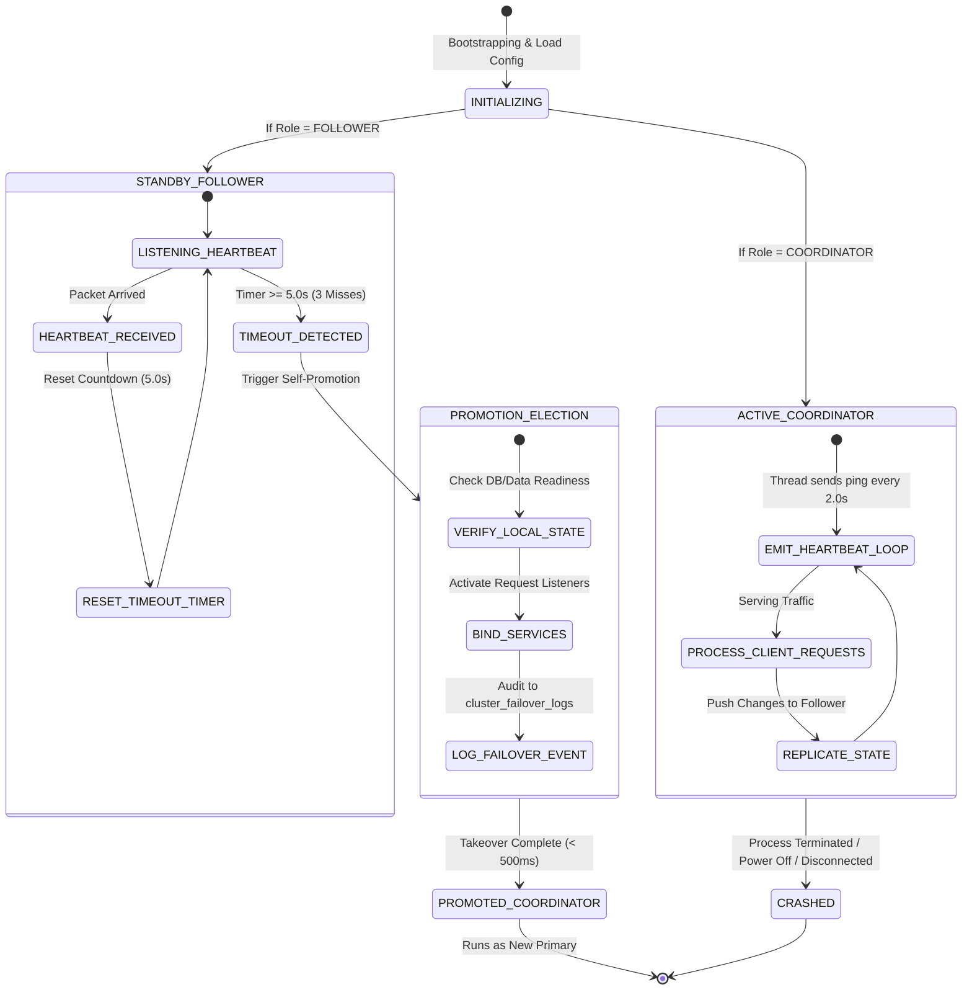
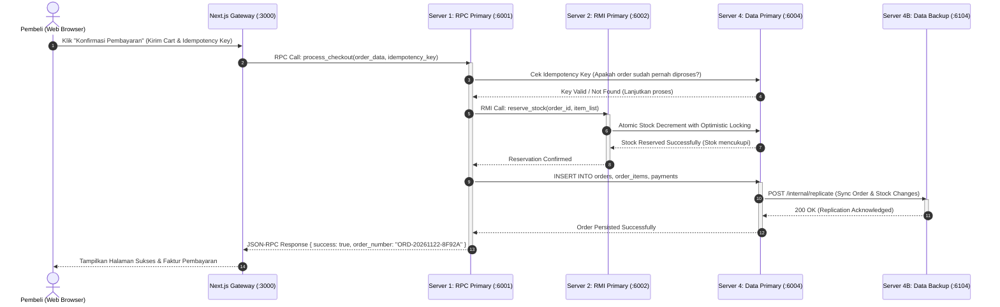
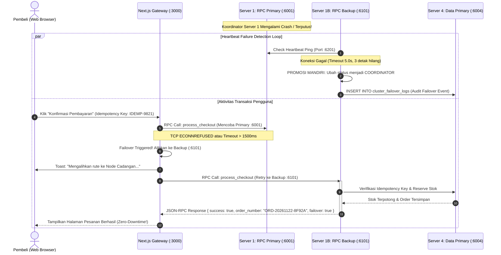

# Spesifikasi Arsitektur Sistem Terdistribusi & Toleransi Kesalahan (Fault Tolerance)
## High Availability Multi-Protocol Distributed E-Commerce Architecture

- **Dokumen Versi:** 2.0.0
- **Status:** Approved for Implementation
- **Domain:** Distributed Systems Topology, Multi-Protocol Communication, Primary-Backup Redundancy, Failover Promotion, State Replication
- **Target Environment:** Multi-Laptop Local Area Network (LAN) & Containerized Deployment

---

## 1. Topologi Arsitektur Sistem Terdistribusi

Sistem ini menerapkan pola arsitektur **Terdesentralisasi Berbasis Layanan (Service-Oriented Distributed Architecture)** dengan redundansi tingkat node menggunakan strategi **Koordinator–Pengikut (Primary–Backup / Hot-Standby)** di setiap tingkatan fungsional. 

### 1.1 Diagram Topologi Jaringan Lengkap (Mermaid)

```mermaid
flowchart TD
    subgraph ClientTier["Tingkat Klien & Gateway (Frontend Web)"]
        Browser["Web Browser (Customer / Admin / Observer)"]
        NextGateway["Next.js 14+ App Router :3000<br/>(Client-Side Failover Router & API Proxy)"]
        Browser <-->|HTTP / WebSocket| NextGateway
    end

    subgraph ServiceTier["Tingkat Layanan Backend Terdistribusi"]
        subgraph ClusterRPC["Layanan Transaksi & Checkout (RPC)"]
            RPC_Coord["Server 1: RPC Koordinator<br/>Primary :6001 (Active)"]
            RPC_Follow["Server 1B: RPC Pengikut<br/>Backup :6101 (Hot-Standby)"]
            RPC_Coord -.->|Heartbeat Thb=2s<br/>(Port :6201)| RPC_Follow
        end

        subgraph ClusterRMI["Layanan Manajemen Stok (RMI)"]
            RMI_Coord["Server 2: RMI Koordinator<br/>Primary :6002 (Active)"]
            RMI_Follow["Server 2B: RMI Pengikut<br/>Backup :6102 (Hot-Standby)"]
            RMI_Coord -.->|Heartbeat Thb=2s<br/>(Port :6202)| RMI_Follow
        end

        subgraph ClusterAPI["Layanan Katalog & Auth (REST API)"]
            API_Coord["Server 3: REST API Koordinator<br/>Primary :6003 (Active)"]
            API_Follow["Server 3B: REST API Pengikut<br/>Backup :6103 (Hot-Standby)"]
            API_Coord -.->|Heartbeat Thb=2s<br/>(Port :6203)| API_Follow
        end
    end

    subgraph DataTier["Tingkat Penyimpanan Data Persisten & Replikasi"]
        subgraph ClusterData["Layanan Basis Data Terdistribusi"]
            DATA_Coord["Server 4: Data Koordinator<br/>Primary :6004 (Active DB)"]
            DATA_Follow["Server 4B: Data Pengikut<br/>Backup :6104 (Replica DB)"]
            DATA_Coord -.->|Heartbeat Thb=2s<br/>(Port :6204)| DATA_Follow
            DATA_Coord ==>|Semi-Sync State Replication<br/>WAL / HTTP POST /internal/replicate| DATA_Follow
        end
    end

    %% Rute Komunikasi Normal Klien ke Koordinator
    NextGateway ==>|1. JSON-RPC (Checkout Call)| RPC_Coord
    NextGateway ==>|2. Remote Method Invocation| RMI_Coord
    NextGateway ==>|3. REST API (Catalog, Cart, Auth)| API_Coord

    %% Rute Failover Cadangan Klien ke Pengikut
    NextGateway -.->|Failover Retry if Primary Down| RPC_Follow
    NextGateway -.->|Failover Retry if Primary Down| RMI_Follow
    NextGateway -.->|Failover Retry if Primary Down| API_Follow

    %% Interaksi Antar Layanan ke Lapisan Data
    RPC_Coord -->|Query & Atomic Commit| DATA_Coord
    RPC_Follow -.->|Fallback Query on Failover| DATA_Coord
    RPC_Follow -.->|Query if Data Primary Down| DATA_Follow

    RMI_Coord -->|Stock Query & Mutate| DATA_Coord
    RMI_Follow -.->|Fallback Stock Mutate| DATA_Coord
    RMI_Follow -.->|Stock Mutate if Data Coord Down| DATA_Follow

    API_Coord -->|Read/Write Operations| DATA_Coord
    API_Follow -.->|Fallback Operations| DATA_Coord
    API_Follow -.->|Operations if Data Coord Down| DATA_Follow
```

### 1.2 Matriks Alokasi Port dan Node

| Layanan Terdistribusi | Node ID | Peran Sistem | Port Layanan Aktif | Port Heartbeat Listener | Protokol Komunikasi |
| :--- | :--- | :--- | :--- | :--- | :--- |
| **Frontend Web App** | `client_web` | Gateway / UI | `3000` | - | HTTP / HTTPS / Next.js Server |
| **Transaksi & Checkout** | `server1_rpc` | Koordinator (Primary) | `6001` | - | TCP Socket (JSON-RPC 2.0) |
| **Transaksi & Checkout** | `server1_rpc_backup` | Pengikut (Follower) | `6101` | `6201` | TCP Socket (JSON-RPC 2.0) |
| **Manajemen Inventaris Stok** | `server2_rmi` | Koordinator (Primary) | `6002` | - | Pyro5 / Socket Object Invocation |
| **Manajemen Inventaris Stok** | `server2_rmi_backup` | Pengikut (Follower) | `6102` | `6202` | Pyro5 / Socket Object Invocation |
| **Katalog, Auth, & Order REST**| `server3_api` | Koordinator (Primary) | `6003` | - | HTTP/1.1 REST (FastAPI / ASGI) |
| **Katalog, Auth, & Order REST**| `server3_api_backup` | Pengikut (Follower) | `6103` | `6203` | HTTP/1.1 REST (FastAPI / ASGI) |
| **Penyimpanan Data Persisten** | `server4_data` | Koordinator (Primary) | `6004` | - | Internal HTTP/JSON Data Service |
| **Penyimpanan Data Persisten** | `server4_data_backup` | Pengikut (Follower) | `6104` | `6204` | Internal HTTP/JSON Data Service |

---

## 2. Spesifikasi Protokol Komunikasi Multi-Layanan

Arsitektur sistem secara sengaja memisahkan protokol komunikasi berdasarkan karakteristik beban kerja (*workload-specific protocol matching*):

### 2.1 Remote Procedure Call (RPC) — `server1_rpc`
- **Fungsi Utama:** Menangani alur transaksi checkout yang kritis, validasi multi-item atomik, dan inisiasi pembayaran pesanan.
- **Karakteristik Kebutuhan:** Eksekusi berkecepatan tinggi, minim *protocol overhead*, komunikasi berorientasi pesan (*message-oriented*), dan verifikasi status idempotensi transaksi.
- **Implementasi Protokol:** **JSON-RPC 2.0 over TCP Socket** dengan framing panjang paket (*Length-Prefixed Framing*):
  - Setiap pesan didahului oleh header 4-byte *big-endian unsigned integer* yang merepresentasikan panjang byte payload JSON.
  - Payload berformat JSON standar yang aman dan dapat diinspeksi (*human-readable/debuggable*), menggantikan `pickle` untuk meniadakan celah keamanan eksekusi kode arbitrer.
- **Remote Procedures yang Tersedia:**
  - `process_checkout(payload: dict) -> dict`
  - `validate_order(order_id: str) -> dict`
  - `cancel_order(order_id: str, reason: str) -> dict`
  - `get_transaction_status(idempotency_key: str) -> dict`

### 2.2 Remote Method Invocation (RMI) — `server2_rmi`
- **Fungsi Utama:** Menyediakan enkapsulasi logika bisnis inventaris barang berbasis paradigma Pemrograman Berorientasi Objek Terdistribusi (*Distributed OOP*).
- **Karakteristik Kebutuhan:** Manipulasi state objek `InventoryService` jarak jauh seolah-olah objek tersebut berada di dalam ruang memori lokal klien (*location transparency*).
- **Implementasi Protokol:** **Pyro5 (Python Remote Objects)** dan/atau Socket Object Invocation terstandarisasi:
  - Objek `InventoryService` didaftarkan pada Nameserver/Daemon di port `6002` (Primary) dan `6102` (Backup).
  - Klien memanggil remote method dengan serialisasi serializer JSON/Serpent yang aman.
- **Metode Objek Remote (`InventoryService`):**
  - `get_stock(product_id: str) -> int`
  - `reserve_stock(order_id: str, items: list[dict]) -> dict`
  - `release_stock(order_id: str, items: list[dict]) -> dict`
  - `restock_product(product_id: str, quantity: int, admin_id: str) -> dict`
  - `batch_check_availability(items: list[dict]) -> dict`

### 2.3 Representational State Transfer (REST API) — `server3_api`
- **Fungsi Utama:** Menyediakan antarmuka publik bagi aplikasi web frontend untuk operasi penjelajahan katalog produk, autentikasi pengguna, manajemen keranjang belanja, dan riwayat pesanan.
- **Karakteristik Kebutuhan:** Kompatibilitas tinggi dengan browser modern, *stateless*, mendukung caching HTTP, dan memiliki validasi skema otomatis.
- **Implementasi Protokol:** **HTTP/1.1 JSON REST API** ditenagai oleh framework **FastAPI** dan ASGI server **Uvicorn**:
  - Validasi ketat menggunakan Pydantic v2.
  - Dokumentasi otomatis via Swagger UI (`/docs`) dan Redoc (`/redoc`).
  - Endpoint pemantauan status kesehatan cluster (`/api/v1/health`).

### 2.4 Internal Data Access Protocol — `server4_data`
- **Fungsi Utama:** Bertindak sebagai lapisan abstraksi data tunggal (*Single Data Access Layer*) yang melindungi database persisten dan mengontrol replikasi data antar node.
- **Implementasi Protokol:** Endpoint internal HTTP/JSON privat (`/internal/db/*`) yang hanya dapat diakses oleh node backend dalam subnet LAN, dilengkapi endpoint khusus replikasi mutasi state (`/internal/replicate`).

---

## 3. Mekanisme Toleransi Kesalahan (Fault Tolerance)

### 3.1 Parameter Deteksi Kegagalan (Heartbeat Parameters)
Deteksi kegagalan antar pasangan node didasarkan pada parameter waktu yang dikalibrasi untuk mencegah *false-positive* akibat fluktuasi sesaat pada jaringan Wi-Fi/LAN:

| Parameter | Simbol | Nilai Default | Deskripsi Fungsional |
| :--- | :---: | :---: | :--- |
| **Interval Heartbeat** | $T_{hb}$ | **2.0 detik** | Periode waktu berkala pengiriman paket ping detak jantung dari Koordinator ke Pengikut. |
| **Batas Ambang Timeout** | $T_{timeout}$ | **5.0 detik** | Durasi ketiadaan sinyal berturut-turut sebelum Pengikut menyatakan Koordinator mati (setara dengan $\approx 2.5 \times T_{hb}$). |
| **Socket Connection Timeout** | $T_{sock\_timeout}$ | **1.5 detik** | Batas waktu tunggu maksimal saat membuka koneksi TCP atau melakukan panggilan request. |
| **Max Consecutive Misses** | $N_{miss\_max}$ | **3 detak** | Jumlah kegagalan pengiriman/penerimaan detak jantung berturut-turut untuk memicu promosi. |
| **Client Retry Backoff** | $T_{retry}$ | **100–300 ms** | Jeda waktu sebelum klien web mengalihkan (*reroute*) request ke alamat node cadangan. |

### 3.2 Siklus Hidup Node & Mesin State (Node State Machine)

Setiap node backend memiliki mesin status (*Finite State Machine*) terstruktur:



### 3.3 Alur Promosi Otomatis (Automatic Failover Promotion)
Ketika Node Koordinator mengalami crash atau terputus dari jaringan lokal:
1. **Deteksi Hilangnya Detak Jantung:** Thread `HeartbeatListener` pada Node Pengikut mendeteksi bahwa timer countdown telah melampaui $T_{timeout} = 5.0$ detik tanpa adanya paket sinyal yang masuk.
2. **Verifikasi Keadaan (*Pre-Promotion Check*):** Node Pengikut melakukan verifikasi internal untuk memastikan tidak terjadi kondisi isolasi jaringan lokal (*split-brain verification* melalui cek gateway/node lain).
3. **Peralihan State Status:** Node Pengikut secara atomik mengubah status internalnya dari `FOLLOWER` menjadi `COORDINATOR`.
4. **Aktivasi Antarmuka Layanan:**
   - Socket listener / HTTP handler yang sebelumnya berstatus pasif langsung diaktifkan untuk menerima koneksi masuk dari Klien Web.
   - Jika node berjalan pada port cadangan (misal: 6101), node mulai memproses seluruh request yang masuk ke port tersebut sebagai koordinator yang sah.
5. **Pencatatan Audit Log Terdistribusi:** Node yang baru dipromosikan menyisipkan catatan riwayat failover ke tabel basis data `cluster_failover_logs`:
   ```json
   {
     "service_name": "server1_rpc",
     "previous_coordinator": "192.168.1.101:6001",
     "promoted_node": "192.168.1.102:6101",
     "reason": "Heartbeat timeout (3 consecutive beats missing > 5000ms)",
     "event_timestamp": "2026-11-22T15:52:10.124Z"
   }
   ```

### 3.4 Mekanisme Replikasi State Real-Time (`server4_data`)
Untuk menjamin konsistensi data persisten dan mencegah hilangnya transaksi pelanggan saat failover:
1. **Topologi Replikasi:** `server4_data` Primary (Port `6004`) bertindak sebagai *Write-Master*, sedangkan `server4_data` Backup (Port `6104`) bertindak sebagai *Read-Replica / Standby-Master*.
2. **Protokol Replikasi Semi-Sinkron (*Semi-Synchronous Replication*):**
   - Setiap operasi yang memodifikasi data (`INSERT`, `UPDATE`, `DELETE`) dieksekusi di database Primary terlebih dahulu di dalam transaksi atomik lokal.
   - Sebelum transaksi dinyatakan selesai ke pemanggil, Primary mengirimkan payload mutasi (*Write-Ahead Event*) melalui panggilan HTTP `POST http://<follower_ip>:6104/internal/replicate`.
   - Follower menerapkan perubahan tersebut ke basis data cadangannya dalam transaksi atomik lokal dan mengembalikan `200 OK` (ACK).
   - Primary menyelesaikan transaksi dan mengembalikan respon sukses ke pemanggil awal.
3. **Struktur Payload Replikasi:**
   ```json
   {
     "replication_seq": 10482,
     "timestamp": "2026-11-22T15:52:12.450Z",
     "table_name": "products",
     "operation": "UPDATE",
     "primary_key": "c1f7a28b-9e45-4a11-823d-0f1e8a93b201",
     "version": 4,
     "changes": {
       "stock": 14,
       "version": 4,
       "updated_at": "2026-11-22T15:52:12.448Z"
     }
   }
   ```
4. **Promosi Data Server:** Apabila `server4_data` Primary mati, `server4_data_backup` secara otonom mempromosikan dirinya menjadi database utama. Karena setiap mutasi sebelumnya telah disinkronkan, **Recovery Point Objective (RPO) = 0** (tanpa data transaksi yang hilang).

### 3.5 Client-Side & Gateway Failover Routing
Frontend Web (Next.js) dan modul proxy internal dilengkapi dengan **Smart Failover Router** dengan mekanisme berikut:
1. **Daftar Target Terurut (*Ordered Endpoint Pool*):** Klien menyimpan konfigurasi alamat pasangan untuk setiap layanan:
   ```typescript
   const SERVICE_ENDPOINTS = {
     rpc: [
       { url: process.env.NEXT_PUBLIC_RPC_PRIMARY_URL || "http://127.0.0.1:6001", role: "PRIMARY" },
       { url: process.env.NEXT_PUBLIC_RPC_BACKUP_URL  || "http://127.0.0.1:6101", role: "BACKUP" }
     ],
     rmi: [
       { url: process.env.NEXT_PUBLIC_RMI_PRIMARY_URL || "http://127.0.0.1:6002", role: "PRIMARY" },
       { url: process.env.NEXT_PUBLIC_RMI_BACKUP_URL  || "http://127.0.0.1:6102", role: "BACKUP" }
     ],
     api: [
       { url: process.env.NEXT_PUBLIC_API_PRIMARY_URL || "http://127.0.0.1:6003", role: "PRIMARY" },
       { url: process.env.NEXT_PUBLIC_API_BACKUP_URL  || "http://127.0.0.1:6103", role: "BACKUP" }
     ]
   };
   ```
2. **Pola Pemanggilan Transparan (*Transparent Retry Pattern*):**
   - Klien mengirimkan request ke target berprioritas pertama (`PRIMARY`).
   - Apabila koneksi berhasil (`HTTP 200` atau RPC `success: true`), respon langsung dikembalikan ke komponen antarmuka.
   - Apabila koneksi gagal karena `ECONNREFUSED`, `ETIMEDOUT`, atau timeout $> 1.5$ detik:
     - Klien secara otomatis menandai node Primary berstatus `TEMPORARILY_OFFLINE`.
     - Request secara transparan dialihkan (*rerouted*) ke target cadangan (`BACKUP`).
     - Komponen UI memicu sinyal peringatan non-intrusif ke store Zustand yang memunculkan toast pemberitahuan: *"Koneksi dialihkan ke Node Cadangan secara transparan"*.
     - Pengguna tidak mengalami halaman crash atau form ter-reset.

---

## 4. Diagram Alur Transaksi & Pemulihan (Mermaid Sequence Diagrams)

### 4.1 Sequence Diagram: Alur Checkout Normal (Seluruh Node Sehat)



### 4.2 Sequence Diagram: Alur Failover Saat Koordinator RPC Mati di Tengah Transaksi



---

## 5. Ringkasan Desain Toleransi Kesalahan

1. **Prinsip Isolasi Kegagalan (*Fault Isolation*):** Kegagalan pada node transaksi (Server 1) tidak mempengaruhi ketersediaan browsing katalog (Server 3) atau manajemen inventaris (Server 2).
2. **Ketiadaan Single Point of Failure (SPOF Elimination):** Setiap tingkatan fungsional dilindungi oleh pasangan redundansi aktif-siaga (*Active-Standby Redundancy*).
3. **Konsistensi Transaksional (*ACID Compliance*):** Protokol pemotongan stok memadukan RPC dengan pemanggilan RMI dan Optimistic Concurrency Control di database PostgreSQL/SQLite untuk mencegah *double spending* dan *overselling*.
4. **Transparansi Klien Penuh (*Full Client Transparency*):** Lapisan frontend secara otonom meredam dampak kegagalan node fisik, menghasilkan pengalaman pengguna yang stabil dan tanpa gangguan.