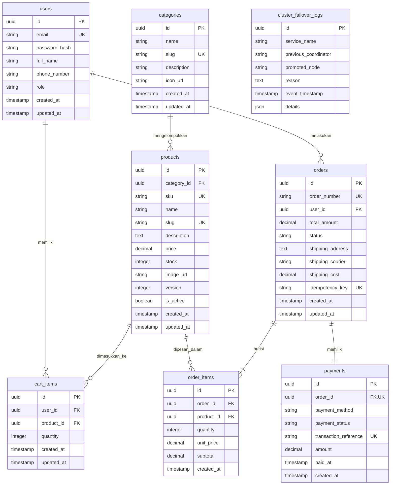

# Desain Skema Database Persisten & Replikasi Terdistribusi
## Relational Data Modeling, Concurrency Control & State Replication

- **Dokumen Versi:** 2.0.0
- **Status:** Approved for Implementation
- **Basis Data Target:** PostgreSQL 15+ (Production) / SQLite 3.40+ dengan WAL Mode (Development / Multi-Laptop Demo)
- **Komponen Pengelola:** `server4_data` (Koordinator :6004 & Pengikut :6104)

---

## 1. Entity-Relationship Diagram (ERD) Lengkap

Diagram relasional di bawah mendefinisikan seluruh entitas, atribut kunci, relasi kardinalitas, dan integritas referensial dalam sistem e-commerce terdistribusi:



---

## 2. Spesifikasi Kolom, Tipe Data, & Batasan (Constraints)

### 2.1 Tabel `users`
Menyimpan akun pengguna untuk pembeli, admin toko, dan observer demo.

| Nama Kolom | Tipe Data | Nullable | Default | Batasan & Aturan Bisnis |
| :--- | :--- | :---: | :---: | :--- |
| `id` | `VARCHAR(36)` | NO | UUIDv4 | Kunci utama (*Primary Key*). |
| `email` | `VARCHAR(255)` | NO | - | Alamat email unik (*Unique Constraint*), format valid. |
| `password_hash` | `VARCHAR(255)` | NO | - | Hash sandi menggunakan Bcrypt (salt rounds 12). |
| `full_name` | `VARCHAR(150)` | NO | - | Nama lengkap pengguna. |
| `phone_number` | `VARCHAR(30)` | YES | NULL | Nomor kontak telepon/WhatsApp pembeli. |
| `role` | `VARCHAR(20)` | NO | `'CUSTOMER'` | Nilai diperbolehkan: `CUSTOMER`, `ADMIN`, `OBSERVER`. |
| `created_at` | `TIMESTAMPTZ` | NO | `NOW()` | Waktu pembuatan akun. |
| `updated_at` | `TIMESTAMPTZ` | NO | `NOW()` | Waktu pembaruan profil terakhir. |

### 2.2 Tabel `categories`
Menyimpan klasifikasi kategori produk untuk pengelompokan katalog.

| Nama Kolom | Tipe Data | Nullable | Default | Batasan & Aturan Bisnis |
| :--- | :--- | :---: | :---: | :--- |
| `id` | `VARCHAR(36)` | NO | UUIDv4 | Kunci utama (*Primary Key*). |
| `name` | `VARCHAR(100)` | NO | - | Nama kategori (contoh: "Elektronik", "Pakaian"). |
| `slug` | `VARCHAR(120)` | NO | - | Identifier unik ramah URL (*Unique Constraint*). |
| `description` | `TEXT` | YES | NULL | Penjelasan lingkup kategori barang. |
| `icon_url` | `VARCHAR(500)` | YES | NULL | Tautan ikon SVG/PNG kategori produk. |
| `created_at` | `TIMESTAMPTZ` | NO | `NOW()` | Waktu registrasi kategori. |
| `updated_at` | `TIMESTAMPTZ` | NO | `NOW()` | Waktu modifikasi kategori. |

### 2.3 Tabel `products`
Menyimpan data katalog produk dan persediaan fisik inventaris.

| Nama Kolom | Tipe Data | Nullable | Default | Batasan & Aturan Bisnis |
| :--- | :--- | :---: | :---: | :--- |
| `id` | `VARCHAR(36)` | NO | UUIDv4 | Kunci utama (*Primary Key*). |
| `category_id` | `VARCHAR(36)` | NO | - | Relasi ke `categories(id)` ON DELETE RESTRICT. |
| `sku` | `VARCHAR(60)` | NO | - | Stock Keeping Unit unik (*Unique Constraint*). |
| `name` | `VARCHAR(255)` | NO | - | Nama lengkap produk komersial. |
| `slug` | `VARCHAR(280)` | NO | - | Slug unik ramah URL (*Unique Constraint*). |
| `description` | `TEXT` | YES | NULL | Rincian deskripsi spesifikasi produk. |
| `price` | `DECIMAL(12,2)` | NO | - | Harga satuan dalam Rupiah (CHECK `price >= 0`). |
| `stock` | `INTEGER` | NO | `0` | Jumlah stok fisik aktual (CHECK `stock >= 0`). |
| `image_url` | `VARCHAR(500)` | YES | NULL | URL gambar utama produk. |
| `version` | `INTEGER` | NO | `1` | **Optimistic Locking Version** untuk proteksi konkurensi. |
| `is_active` | `BOOLEAN` | NO | `TRUE` | Status visibilitas di storefront katalog. |
| `created_at` | `TIMESTAMPTZ` | NO | `NOW()` | Waktu produk ditambahkan. |
| `updated_at` | `TIMESTAMPTZ` | NO | `NOW()` | Waktu modifikasi data/stok terakhir. |

### 2.4 Tabel `cart_items`
Menyimpan item keranjang belanja persisten pengguna yang terautentikasi.

| Nama Kolom | Tipe Data | Nullable | Default | Batasan & Aturan Bisnis |
| :--- | :--- | :---: | :---: | :--- |
| `id` | `VARCHAR(36)` | NO | UUIDv4 | Kunci utama (*Primary Key*). |
| `user_id` | `VARCHAR(36)` | NO | - | Relasi ke `users(id)` ON DELETE CASCADE. |
| `product_id` | `VARCHAR(36)` | NO | - | Relasi ke `products(id)` ON DELETE CASCADE. |
| `quantity` | `INTEGER` | NO | `1` | Kuantitas dipesan (CHECK `quantity > 0`). |
| `created_at` | `TIMESTAMPTZ` | NO | `NOW()` | Waktu item pertama kali dimasukkan keranjang. |
| `updated_at` | `TIMESTAMPTZ` | NO | `NOW()` | Waktu kuantitas diubah terakhir kali. |
| **Constraint** | `UNIQUE` | - | - | Pasangan `(user_id, product_id)` harus unik. |

### 2.5 Tabel `orders`
Menyimpan data induk transaksi pemesanan barang.

| Nama Kolom | Tipe Data | Nullable | Default | Batasan & Aturan Bisnis |
| :--- | :--- | :---: | :---: | :--- |
| `id` | `VARCHAR(36)` | NO | UUIDv4 | Kunci utama (*Primary Key*). |
| `order_number` | `VARCHAR(40)` | NO | - | Kode unik pesanan, misal: `ORD-20261122-8F92A`. |
| `user_id` | `VARCHAR(36)` | NO | - | Relasi ke `users(id)` ON DELETE RESTRICT. |
| `total_amount` | `DECIMAL(14,2)` | NO | - | Total tagihan pesanan (barang + ongkir). |
| `status` | `VARCHAR(30)` | NO | `'PENDING'` | `PENDING`, `PAID`, `PROCESSING`, `SHIPPED`, `DELIVERED`, `CANCELLED`. |
| `shipping_address` | `TEXT` | NO | - | Alamat tujuan pengiriman lengkap. |
| `shipping_courier` | `VARCHAR(50)` | NO | - | Nama ekspedisi kurir (contoh: "JNE Regular"). |
| `shipping_cost` | `DECIMAL(10,2)` | NO | `0.00` | Biaya ongkos kirim logistik. |
| `idempotency_key` | `VARCHAR(100)` | NO | - | **UUID Idempotensi** unik mencegah double submit. |
| `created_at` | `TIMESTAMPTZ` | NO | `NOW()` | Waktu pesanan dibuat. |
| `updated_at` | `TIMESTAMPTZ` | NO | `NOW()` | Waktu pembaruan status pesanan. |

### 2.6 Tabel `order_items`
Menyimpan rincian setiap produk dalam sebuah pesanan.

| Nama Kolom | Tipe Data | Nullable | Default | Batasan & Aturan Bisnis |
| :--- | :--- | :---: | :---: | :--- |
| `id` | `VARCHAR(36)` | NO | UUIDv4 | Kunci utama (*Primary Key*). |
| `order_id` | `VARCHAR(36)` | NO | - | Relasi ke `orders(id)` ON DELETE CASCADE. |
| `product_id` | `VARCHAR(36)` | NO | - | Relasi ke `products(id)` ON DELETE RESTRICT. |
| `quantity` | `INTEGER` | NO | - | Jumlah unit barang yang dibeli (CHECK `quantity > 0`). |
| `unit_price` | `DECIMAL(12,2)` | NO | - | Harga barang saat transaksi dibekukan (*snapshot*). |
| `subtotal` | `DECIMAL(14,2)` | NO | - | Hasil kalkulasi `quantity * unit_price`. |
| `created_at` | `TIMESTAMPTZ` | NO | `NOW()` | Waktu item pesanan dicatat. |

### 2.7 Tabel `payments`
Menyimpan status dan informasi pembayaran pesanan.

| Nama Kolom | Tipe Data | Nullable | Default | Batasan & Aturan Bisnis |
| :--- | :--- | :---: | :---: | :--- |
| `id` | `VARCHAR(36)` | NO | UUIDv4 | Kunci utama (*Primary Key*). |
| `order_id` | `VARCHAR(36)` | NO | - | Relasi 1-to-1 ke `orders(id)` ON DELETE CASCADE (UNIQUE). |
| `payment_method` | `VARCHAR(40)` | NO | - | `BANK_TRANSFER`, `E_WALLET`, `COD`. |
| `payment_status` | `VARCHAR(30)` | NO | `'UNPAID'` | Nilai: `UNPAID`, `PAID`, `FAILED`. |
| `transaction_reference`| `VARCHAR(100)` | YES | NULL | Nomor referensi/VA transaksi pembayaran eksternal. |
| `amount` | `DECIMAL(14,2)` | NO | - | Nominal yang dibayarkan oleh customer. |
| `paid_at` | `TIMESTAMPTZ` | YES | NULL | Waktu stempel pembayaran terkonfirmasi lunas. |
| `created_at` | `TIMESTAMPTZ` | NO | `NOW()` | Waktu inisiasi pembayaran. |

### 2.8 Tabel `cluster_failover_logs`
Menyimpan riwayat audit perpindahan peran dan kegagalan node untuk monitoring dan analisis sistem terdistribusi.

| Nama Kolom | Tipe Data | Nullable | Default | Batasan & Aturan Bisnis |
| :--- | :--- | :---: | :---: | :--- |
| `id` | `VARCHAR(36)` | NO | UUIDv4 | Kunci utama (*Primary Key*). |
| `service_name` | `VARCHAR(50)` | NO | - | Nama layanan (`server1_rpc`, `server2_rmi`, `server3_api`, `server4_data`). |
| `previous_coordinator`| `VARCHAR(100)` | NO | - | Host & Port koordinator lama yang mengalami crash. |
| `promoted_node` | `VARCHAR(100)` | NO | - | Host & Port pengikut yang dipromosikan. |
| `reason` | `TEXT` | NO | - | Penyebab promosi (misal: "Heartbeat timeout 3x"). |
| `event_timestamp` | `TIMESTAMPTZ` | NO | `NOW()` | Waktu terjadinya failover secara presisi. |
| `details` | `TEXT` | YES | NULL | Data JSON tambahan (latensi, sisa request tertunda, dll). |

---

## 3. Optimistic Concurrency Control (OCC) & Anti-Overselling

Dalam sistem e-commerce terdistribusi, risiko tertinggi terjadi ketika dua pembeli melakukan checkout produk yang sama secara simultan pada saat stok tersisa hanya 1 unit (*Race Condition*).

### 3.1 Logika Eksekusi Atomic Update
Sistem tidak menggunakan pesimistik locking (`SELECT ... FOR UPDATE`) yang rentan menyebabkan *deadlock* dan menurunkan throughput transaksi terdistribusi. Sebaliknya, sistem menggunakan **Optimistic Concurrency Control (OCC)** dengan klausa `version` dan `stock` bersyarat:

```sql
UPDATE products 
SET 
    stock = stock - :requested_quantity,
    version = version + 1,
    updated_at = CURRENT_TIMESTAMP
WHERE 
    id = :product_id 
    AND version = :expected_version
    AND stock >= :requested_quantity;
```

### 3.2 Alur Eksekusi Pemotongan Stok pada `server2_rmi`

```python
def reserve_stock(self, order_id: str, items: list[dict]) -> dict:
    """
    Eksekusi atomic stock reservation dengan verifikasi OCC.
    Items format: [{"product_id": "...", "quantity": 2}, ...]
    """
    db = self.get_database_connection()
    max_retries = 3
    
    for attempt in range(max_retries):
        try:
            db.begin_transaction()
            # 1. Periksa ketersediaan dan ambil versi terkini
            for item in items:
                row = db.query_one(
                    "SELECT stock, version FROM products WHERE id = :id AND is_active = TRUE",
                    {"id": item["product_id"]}
                )
                if not row or row["stock"] < item["quantity"]:
                    db.rollback()
                    return {
                        "success": False, 
                        "error_code": "INSUFFICIENT_STOCK",
                        "product_id": item["product_id"],
                        "message": f"Stok tidak mencukupi untuk item {item['product_id']}"
                    }
                
                # 2. Eksekusi pengurangan atomik dengan pencocokan versi
                affected_rows = db.execute(
                    """
                    UPDATE products 
                    SET stock = stock - :qty, version = version + 1, updated_at = NOW()
                    WHERE id = :id AND version = :version AND stock >= :qty
                    """,
                    {
                        "qty": item["quantity"],
                        "id": item["product_id"],
                        "version": row["version"]
                    }
                )
                
                if affected_rows == 0:
                    # Terjadi modifikasi paralel oleh transaksi lain -> Picu Retry
                    raise ConcurrencyConflictException("Optimistic lock conflict detected")

            db.commit()
            return {"success": True, "order_id": order_id, "reserved_items": items}

        except ConcurrencyConflictException:
            db.rollback()
            time.sleep(0.05 * (attempt + 1)) # Backoff jitter 50ms, 100ms
            continue
            
    return {
        "success": False,
        "error_code": "CONCURRENCY_TIMEOUT",
        "message": "Gagal mengalokasikan stok akibat tingginya transaksi konkuren. Silakan coba kembali."
    }
```

---

## 4. Mekanisme Sinkronisasi & Replikasi Data Terdistribusi

Lapisan `server4_data` mengoperasikan dua instance basis data:
- **Data Koordinator (Primary :6004):** Menerima operasi baca (*read*) dan tulis (*write*).
- **Data Pengikut (Follower / Backup :6104):** Siaga menerima streaming replikasi mutasi dan melayani pembacaan cadangan.

```mermaid
flowchart LR
    Caller["Layanan Server 1/2/3"]
    DataCoord["Server 4: Data Koordinator :6004"]
    LocalDB1[("Primary Database")]
    DataFollow["Server 4B: Data Pengikut :6104"]
    LocalDB2[("Replica Database")]

    Caller -->|1. Write Transaction HTTP POST /internal/db/execute| DataCoord
    DataCoord -->|2. Local Atomic Commit| LocalDB1
    DataCoord -->|3. Streaming Replikasi HTTP POST /internal/replicate| DataFollow
    DataFollow -->|4. Replay Mutation Atomically| LocalDB2
    DataFollow -->>|5. ACK 200 OK| DataCoord
    DataCoord -->>|6. Transaction Success Response| Caller
```

### 4.1 Spesifikasi Endpoint Replikasi (`server4_data`)
- **Endpoint:** `POST /internal/replicate`
- **Tipe Payload:** `application/json`
- **Format Payload:**
  ```json
  {
    "event_id": "a901f4c2-5b92-4f01-9231-98a72b104921",
    "sequence_id": 14029,
    "source_node": "server4_coordinator:6004",
    "table_name": "orders",
    "operation_type": "INSERT",
    "record_id": "b3f88c12-3498-4421-bc77-9811234a5678",
    "timestamp": "2026-11-22T15:52:45.102Z",
    "payload": {
      "id": "b3f88c12-3498-4421-bc77-9811234a5678",
      "order_number": "ORD-20261122-8F92A",
      "user_id": "u1092-4912-bb21",
      "total_amount": 250000.00,
      "status": "PENDING",
      "shipping_address": "Jl. Raya Telang No. 1, Bangkalan, Madura",
      "shipping_courier": "JNE Regular",
      "shipping_cost": 15000.00,
      "idempotency_key": "IDEMP-8921-UUID",
      "created_at": "2026-11-22T15:52:45.100Z",
      "updated_at": "2026-11-22T15:52:45.100Z"
    }
  }
  ```

### 4.2 Prosedur Sinkronisasi Pemulihan Pasca-Kegagalan (Catch-Up Synchronization)
Apabila node koordinator lama pulih kembali (*re-join cluster*) setelah mengalami kegagalan:
1. Node yang pulih dilarang langsung menjadi koordinator (*No Split-Brain*). Node wajib masuk sebagai `FOLLOWER`.
2. Node mengirimkan permintaan rekonsiliasi state ke Koordinator aktif:
   `GET /internal/sync/catchup?last_sequence_id=<sequence_terakhir>`
3. Koordinator aktif mengirimkan kumpulan log perubahan yang terjadi selama node tersebut offline.
4. Node yang pulih mengaplikasikan seluruh log tersebut hingga nilai `sequence_id` sepenuhnya identik dengan Koordinator aktif.

---

## 5. DDL Lengkap (PostgreSQL / SQLite Compatible SQL Schema)

Skrip SQL berikut dapat langsung dieksekusi untuk inisialisasi struktur basis data:

```sql
-- Inisialisasi Ekstensi UUID (PostgreSQL)
CREATE EXTENSION IF NOT EXISTS "uuid-ossp";

-- 1. Tabel Users
CREATE TABLE IF NOT EXISTS users (
    id VARCHAR(36) PRIMARY KEY,
    email VARCHAR(255) NOT NULL UNIQUE,
    password_hash VARCHAR(255) NOT NULL,
    full_name VARCHAR(150) NOT NULL,
    phone_number VARCHAR(30),
    role VARCHAR(20) NOT NULL DEFAULT 'CUSTOMER' CHECK (role IN ('CUSTOMER', 'ADMIN', 'OBSERVER')),
    created_at TIMESTAMP WITH TIME ZONE DEFAULT CURRENT_TIMESTAMP,
    updated_at TIMESTAMP WITH TIME ZONE DEFAULT CURRENT_TIMESTAMP
);

-- 2. Tabel Categories
CREATE TABLE IF NOT EXISTS categories (
    id VARCHAR(36) PRIMARY KEY,
    name VARCHAR(100) NOT NULL,
    slug VARCHAR(120) NOT NULL UNIQUE,
    description TEXT,
    icon_url VARCHAR(500),
    created_at TIMESTAMP WITH TIME ZONE DEFAULT CURRENT_TIMESTAMP,
    updated_at TIMESTAMP WITH TIME ZONE DEFAULT CURRENT_TIMESTAMP
);

-- 3. Tabel Products
CREATE TABLE IF NOT EXISTS products (
    id VARCHAR(36) PRIMARY KEY,
    category_id VARCHAR(36) NOT NULL REFERENCES categories(id) ON DELETE RESTRICT,
    sku VARCHAR(60) NOT NULL UNIQUE,
    name VARCHAR(255) NOT NULL,
    slug VARCHAR(280) NOT NULL UNIQUE,
    description TEXT,
    price DECIMAL(12,2) NOT NULL CHECK (price >= 0),
    stock INTEGER NOT NULL DEFAULT 0 CHECK (stock >= 0),
    image_url VARCHAR(500),
    version INTEGER NOT NULL DEFAULT 1,
    is_active BOOLEAN NOT NULL DEFAULT TRUE,
    created_at TIMESTAMP WITH TIME ZONE DEFAULT CURRENT_TIMESTAMP,
    updated_at TIMESTAMP WITH TIME ZONE DEFAULT CURRENT_TIMESTAMP
);

-- 4. Tabel Cart Items
CREATE TABLE IF NOT EXISTS cart_items (
    id VARCHAR(36) PRIMARY KEY,
    user_id VARCHAR(36) NOT NULL REFERENCES users(id) ON DELETE CASCADE,
    product_id VARCHAR(36) NOT NULL REFERENCES products(id) ON DELETE CASCADE,
    quantity INTEGER NOT NULL DEFAULT 1 CHECK (quantity > 0),
    created_at TIMESTAMP WITH TIME ZONE DEFAULT CURRENT_TIMESTAMP,
    updated_at TIMESTAMP WITH TIME ZONE DEFAULT CURRENT_TIMESTAMP,
    CONSTRAINT uq_user_product UNIQUE (user_id, product_id)
);

-- 5. Tabel Orders
CREATE TABLE IF NOT EXISTS orders (
    id VARCHAR(36) PRIMARY KEY,
    order_number VARCHAR(40) NOT NULL UNIQUE,
    user_id VARCHAR(36) NOT NULL REFERENCES users(id) ON DELETE RESTRICT,
    total_amount DECIMAL(14,2) NOT NULL CHECK (total_amount >= 0),
    status VARCHAR(30) NOT NULL DEFAULT 'PENDING' CHECK (status IN ('PENDING', 'PAID', 'PROCESSING', 'SHIPPED', 'DELIVERED', 'CANCELLED')),
    shipping_address TEXT NOT NULL,
    shipping_courier VARCHAR(50) NOT NULL,
    shipping_cost DECIMAL(10,2) NOT NULL DEFAULT 0.00 CHECK (shipping_cost >= 0),
    idempotency_key VARCHAR(100) NOT NULL UNIQUE,
    created_at TIMESTAMP WITH TIME ZONE DEFAULT CURRENT_TIMESTAMP,
    updated_at TIMESTAMP WITH TIME ZONE DEFAULT CURRENT_TIMESTAMP
);

-- 6. Tabel Order Items
CREATE TABLE IF NOT EXISTS order_items (
    id VARCHAR(36) PRIMARY KEY,
    order_id VARCHAR(36) NOT NULL REFERENCES orders(id) ON DELETE CASCADE,
    product_id VARCHAR(36) NOT NULL REFERENCES products(id) ON DELETE RESTRICT,
    quantity INTEGER NOT NULL CHECK (quantity > 0),
    unit_price DECIMAL(12,2) NOT NULL CHECK (unit_price >= 0),
    subtotal DECIMAL(14,2) NOT NULL CHECK (subtotal >= 0),
    created_at TIMESTAMP WITH TIME ZONE DEFAULT CURRENT_TIMESTAMP
);

-- 7. Tabel Payments
CREATE TABLE IF NOT EXISTS payments (
    id VARCHAR(36) PRIMARY KEY,
    order_id VARCHAR(36) NOT NULL UNIQUE REFERENCES orders(id) ON DELETE CASCADE,
    payment_method VARCHAR(40) NOT NULL CHECK (payment_method IN ('BANK_TRANSFER', 'E_WALLET', 'COD')),
    payment_status VARCHAR(30) NOT NULL DEFAULT 'UNPAID' CHECK (payment_status IN ('UNPAID', 'PAID', 'FAILED')),
    transaction_reference VARCHAR(100) UNIQUE,
    amount DECIMAL(14,2) NOT NULL CHECK (amount >= 0),
    paid_at TIMESTAMP WITH TIME ZONE,
    created_at TIMESTAMP WITH TIME ZONE DEFAULT CURRENT_TIMESTAMP
);

-- 8. Tabel Cluster Failover Logs
CREATE TABLE IF NOT EXISTS cluster_failover_logs (
    id VARCHAR(36) PRIMARY KEY,
    service_name VARCHAR(50) NOT NULL,
    previous_coordinator VARCHAR(100) NOT NULL,
    promoted_node VARCHAR(100) NOT NULL,
    reason TEXT NOT NULL,
    event_timestamp TIMESTAMP WITH TIME ZONE DEFAULT CURRENT_TIMESTAMP,
    details TEXT
);

-- Indeks Kinerja Tinggi
CREATE INDEX IF NOT EXISTS idx_products_category_price ON products (category_id, price);
CREATE INDEX IF NOT EXISTS idx_products_sku ON products (sku);
CREATE INDEX IF NOT EXISTS idx_products_slug ON products (slug);
CREATE INDEX IF NOT EXISTS idx_orders_user_created ON orders (user_id, created_at DESC);
CREATE INDEX IF NOT EXISTS idx_orders_idempotency ON orders (idempotency_key);
CREATE INDEX IF NOT EXISTS idx_failover_timestamp ON cluster_failover_logs (event_timestamp DESC);
```