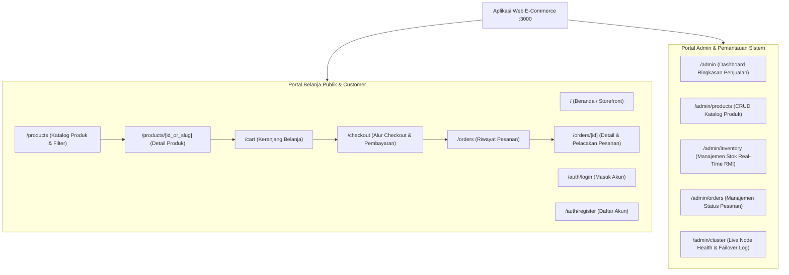

# Desain Sistem Antarmuka & Pengalaman Pengguna (UI/UX Design System)
## High-Availability E-Commerce Frontend Architecture & Design Specification

- **Dokumen Versi:** 2.0.0
- **Status:** Approved for Implementation
- **Tech Stack Frontend:** Next.js 14+ (App Router), TypeScript, Tailwind CSS, Shadcn/UI, Lucide React, Zustand State Management
- **Peran Penyusun:** Principal UI/UX Lead & Senior Product Designer

---

## 1. Sitemap & Arsitektur Informasi (Information Architecture)

Peta situs dikelompokkan ke dalam dua area navigasi utama: **Storefront Publik & Akun Pengguna (Customer Realm)** dan **Portal Manajemen Operasional (Admin & Observer Realm)**.



---

## 2. Struktur Halaman & Spesifikasi Wireframe

### 2.1 Halaman Beranda & Storefront (`/`)
- **Header / Navigation Bar (Sticky Top):**
  - Kiri: Logo Toko & Nama Brand e-commerce (*SisterShop*).
  - Tengah: Input pencarian global dengan ikon kaca pembesar dan shortcut `Ctrl + K`.
  - Kanan: Pemilih kategori cepat, Ikon Keranjang Belanja dengan badge kuantitas merah (*counter badge*), Avatar Profil / Tombol Masuk.
- **Hero Banner Carousel:**
  - Menampilkan promosi unggulan dan kampanye diskon.
- **Kategori Pilihan (Category Pills):**
  - Baris kartu horizontal scrollable yang menampilkan kategori ikonik.
- **Produk Unggulan & Flash Sale Grid:**
  - Grid 4 kolom (desktop) atau 2 kolom (mobile) kartu produk dengan penanda stok terbatas.
- **Footer Terpadu dengan Health Status Pill:**
  - Informasi legal, metode pembayaran yang didukung, dan **Cluster Status Mini-Indicator** di sudut kanan bawah.

### 2.2 Halaman Katalog Produk (`/products`)
- **Sidebar Filter (Kiri pada Desktop, Drawer Bottom-Sheet pada Mobile):**
  - **Filter Kategori:** Checkbox list kategori produk.
  - **Filter Rentang Harga:** Slider interaktif ganda dengan input nominal minimum dan maksimum.
  - **Filter Ketersediaan:** Switch toggle *"Hanya tampilkan produk tersedia (Stok > 0)"*.
  - **Tombol Reset Filter:** Menghapus seluruh filter dalam satu klik.
- **Katalog Grid & Sort Bar (Kanan):**
  - Header informasi jumlah produk ditemukan (misal: "Menampilkan 24 produk").
  - Dropdown pengurutan: `Terbaru`, `Harga Terendah`, `Harga Tertinggi`, `Nama (A-Z)`.
  - Kartu Produk (*Product Card*):
    - Foto produk dengan aspek rasio 1:1 dan efek hover zoom halus.
    - Tag Kategori produk.
    - Nama produk (maksimal 2 baris teks truncate).
    - Format harga Rupiah tebal (contoh: `Rp 12.500.000`).
    - Status stok: Label hijau `"Tersedia: 18 unit"` atau merah `"Stok Habis"`.
    - Tombol aksi: `"Tambah ke Keranjang"` atau tombol dinonaktifkan jika stok 0.
  - Komponen Paginasi: Tombol `Sebelumnya`, Nomor Halaman aktif, dan `Berikutnya`.

### 2.3 Halaman Detail Produk (`/products/[id_or_slug]`)
- **Breadcrumb Navigasi:** `Beranda > Elektronik & Gadget > Laptop UltraBook Pro 14 Inch`.
- **Kolom Kiri (Galeri Media):**
  - Tampilan gambar utama berresolusi tinggi dengan lightbox zoom.
  - Thumbnail gambar alternatif di bawah gambar utama.
- **Kolom Kanan (Informasi & Pembelian):**
  - Judul Produk & Nomor SKU unik.
  - Harga satuan tercetak besar.
  - Badge Status Stok: Mengambil data stok mutakhir secara real-time.
  - Tab Navigasi: `Deskripsi Lengkap`, `Spesifikasi Teknis`, `Ketentuan Garansi`.
  - Kontrol Kuantitas: Tombol minus `[-]`, input angka, tombol plus `[+]` dengan batasan validasi `max = stock`.
  - Tombol Aksi Ganda:
    - Tombol Outline: `+ Keranjang Belanja`.
    - Tombol Solid Utama: `Beli Sekarang (Langsung Checkout)`.

### 2.4 Halaman Keranjang Belanja (`/cart`)
- **Tata Letak Dua Kolom:**
  - **Kolom Kiri (Daftar Item Keranjang):**
    - Setiap item memiliki: Foto thumbnail, nama barang, harga satuan, selector kuantitas dinamis `[- 1 +]`, kalkulasi subtotal item, dan tombol hapus (ikon tempat sampah).
    - Peringatan stok menipis jika kuantitas mendekati sisa stok fisik.
  - **Kolom Kanan (Ringkasan Belanja):**
    - Subtotal Produk.
    - Estimasi Pajak / Biaya Layanan.
    - Total Tagihan Belanja.
    - Tombol CTA Utama: `"Lanjut ke Pembayaran (Checkout)"`.

### 2.5 Halaman Checkout (`/checkout`)
- **Formulir Terpandu Tiga Langkah (Step-by-Step Checkout):**
  1. **Alamat Pengiriman:** Pilihan alamat tersimpan atau input alamat baru (Nama penerima, telepon, alamat jalan, kota, kode pos).
  2. **Metode Ekspedisi & Ongkir:** Pilihan kurir dengan tarif otomatis (JNE Regular: Rp 15.000, JNE Express: Rp 20.000, SiCepat: Rp 14.000).
  3. **Metode Pembayaran:** 
     - Transfer Bank (Virtual Account Mandiri / BCA / BNI).
     - E-Wallet QRIS (Pembayaran instan).
     - Cash on Delivery (COD).
- **Rincian Pesanan & Idempotensi Transaksi:**
  - Menampilkan ringkasan seluruh produk yang dipesan.
  - Tombol submit `"Konfirmasi & Bayar Sekarang"`.
  - Klien secara otomatis menghasilkan `X-Idempotency-Key` UUIDv4 sebelum payload dikirimkan ke node RPC.

### 2.6 Portal Monitoring Cluster Terdistribusi (`/admin/cluster`)
Halaman khusus untuk evaluasi dosen penguji dan audit sistem terdistribusi:

```
+----------------------------------------------------------------------------------------------------+
|  SISTEM TERDISTRIBUSI - LIVE CLUSTER & FAULT TOLERANCE MONITOR                                     |
+----------------------------------------------------------------------------------------------------+
|  [Status Cluster: OPERASIONAL SEHAT]   |   [Heartbeat: 2.0s]   |   [Timeout: 5.0s (3 Misses)]      |
+----------------------------------------------------------------------------------------------------+
|                                                                                                    |
|  NODE STATUS MATRIKS:                                                                              |
|  +----------------------------+  +----------------------------+  +-------------------------------+ |
|  | Server 1: RPC Transaksi    |  | Server 2: RMI Inventaris   |  | Server 3: REST API Katalog    | |
|  | Primary :6001 [ONLINE] 💚  |  | Primary :6002 [ONLINE] 💚  |  | Primary :6003 [ONLINE] 💚     | |
|  | Backup  :6101 [STANDBY] 💛 |  | Backup  :6102 [STANDBY] 💛 |  | Backup  :6103 [STANDBY] 💛    | |
|  | Heartbeat: Normal (12ms)   |  | Heartbeat: Normal (8ms)    |  | Heartbeat: Normal (15ms)      | |
|  | [Simulasikan Crash Server1]|  | [Simulasikan Crash Server2]|  | [Simulasikan Crash Server3]   | |
|  +----------------------------+  +----------------------------+  +-------------------------------+ |
|                                                                                                    |
|  +----------------------------+                                                                    |
|  | Server 4: Data & Replikasi |                                                                    |
|  | Primary :6004 [ACTIVE] 💚  |                                                                    |
|  | Backup  :6104 [SYNCED] 💚  |                                                                    |
|  | Replikasi: Real-time (0ms) |                                                                    |
|  | [Simulasikan Crash Data]   |                                                                    |
|  +----------------------------+                                                                    |
|                                                                                                    |
|  AUDIT LOG PERISTIWA FAILOVER TERAKHIR (cluster_failover_logs):                                    |
|  +---------------------+--------------+-------------------+---------------+----------------------+ |
|  | Timestamp           | Service      | Failed Node       | Promoted Node | Reason / Notes       | |
|  +---------------------+--------------+-------------------+---------------+----------------------+ |
|  | 2026-11-22 15:52:10 | server1_rpc  | 192.168.1.101:6001| ...:6101      | Timeout 3x beats lost| |
|  +---------------------+--------------+-------------------+---------------+----------------------+ |
+----------------------------------------------------------------------------------------------------+
```

---

## 3. Sistem Desain: Warna, Tipografi, & Komponen

### 3.1 Palet Warna Semantik
Sistem desain menerapkan pendekatan palet warna modern, bersih, dan kontras tinggi:

| Token Warna | Nilai HEX / Tailwind | Penggunaan Fungsional |
| :--- | :--- | :--- |
| `primary` | `#2563EB` (`blue-600`) | Warna utama aksi CTA, link aktif, dan elemen interaktif. |
| `primary-hover` | `#1D4ED8` (`blue-700`) | State hover tombol utama. |
| `secondary` | `#F1F5F9` (`slate-100`) | Latar belakang elemen kartu, panel sidebar, dan badge netral. |
| `accent` | `#0D9488` (`teal-600`) | Aksen sorotan promosi dan badge kategori unggulan. |
| `background` | `#FFFFFF` / `#0F172A` | Latar belakang halaman (mendukung tema Light & Dark Mode). |
| `foreground` | `#0F172A` (`slate-900`) | Warna teks primer dengan tingkat keterbacaan tinggi. |
| `muted-foreground` | `#64748B` (`slate-500`)| Teks sekunder, label pembantu, dan timestamp. |
| `success` | `#16A34A` (`green-600`)| Indikator stok tersedia, pembayaran berhasil, node `ONLINE`. |
| `warning` | `#D97706` (`amber-600`)| Stok menipis (< 5), node `STANDBY / HOT-STANDBY`. |
| `destructive` | `#DC2626` (`red-600`) | Stok habis, pembatalan pesanan, node `CRASHED / DOWN`. |
| `failover-notice` | `#7C3AED` (`purple-600`)| Notifikasi toast saat terjadi rerouting failover transparan. |

### 3.2 Tipografi
- **Font Utama (Interface & Body):** `Inter`, `-apple-system`, `BlinkMacSystemFont`, `Segoe UI`, `sans-serif`.
- **Font Angka & Monospace (Harga & Cluster Log):** `JetBrains Mono`, `Fira Code`, `ui-monospace`.
- **Hierarki Skala Ukuran Teks:**
  - `H1` (Judul Hero / Halaman Utama): `2.25rem` (36px) — Bold (700)
  - `H2` (Judul Bagian / Kategori): `1.75rem` (28px) — SemiBold (600)
  - `H3` (Judul Kartu / Modal): `1.25rem` (20px) — SemiBold (600)
  - `Body Regular`: `1.0rem` (16px) — Regular (400)
  - `Caption / Small`: `0.875rem` (14px) — Medium (500)
  - `Badge / Monospace`: `0.75rem` (12px) — SemiBold (600)

---

## 4. Penanganan State UI (UI State Management)

### 4.1 Loading Skeletons
Untuk mencegah pergeseran tata letak (*Cumulative Layout Shift / CLS*) saat data diambil dari REST API:
- **Katalog Produk:** Menampilkan 8–12 kartu skeleton abu-abu berdenyut halus (*shimmer animation*) menyerupai kartu produk sesungguhnya.
- **Detail Produk:** Skeleton gambar kotak besar di sisi kiri dan 4 baris teks skeleton di sisi kanan.
- **Keranjang Belanja:** Skeleton baris tabel item belanja dengan tombol placeholder.

### 4.2 Empty States (Status Data Kosong)
- **Keranjang Kosong (`CartEmpty`):**
  - Ilustrasi vektor keranjang belanja kosong.
  - Teks: *"Keranjang belanjamu masih kosong"*.
  - Subteks: *"Temukan berbagai produk berkualitas di katalog kami dan mulai berbelanja!"*.
  - Tombol CTA: `"Mulai Jelajahi Produk"`.
- **Pesanan Belum Ada (`OrdersEmpty`):**
  - Ilustrasi dokumen faktur kosong.
  - Teks: *"Belum ada riwayat pesanan"*.
  - Tombol CTA: `"Belanja Sekarang"`.
- **Pencarian Tidak Ditemukan (`SearchEmpty`):**
  - Teks: *"Tidak ditemukan produk untuk kata kunci '{keyword}'"*.
  - Saran: Coba periksa ejaan atau gunakan filter kategori lain.

### 4.3 Penanganan Notifikasi Toast & Failover Alert
Sistem menggunakan modul toast berbasis **Sonner / Shadcn Toast** yang dikendalikan oleh Zustand failover listener:

1. **Notifikasi Transaksi Sukses:**
   - Variasi: `toast.success`
   - Judul: *"Pesanan Berhasil Dibuat!"*
   - Deskripsi: *"Nomor Pesanan: ORD-20261122-8F92A. Silakan selesaikan pembayaran."*
2. **Notifikasi Automatic Failover Transparan (Kunci Pengujian Sistem Terdistribusi):**
   - Variasi: `toast.info` (dengan ikon petir dan warna ungu/biru)
   - Judul: *"Toleransi Kesalahan Sistem Aktif"*
   - Deskripsi: *"Koneksi dialihkan secara transparan dari Koordinator Utama ke Node Cadangan (:6101). Transaksi Anda tetap diproses dengan aman tanpa gangguan."*
   - Durasi Tampil: 6.0 detik.
3. **Notifikasi Kesalahan Stok:**
   - Variasi: `toast.error`
   - Judul: *"Persediaan Tidak Mencukupi"*
   - Deskripsi: *"Seseorang baru saja membeli stok terakhir barang ini. Kuantitas keranjang Anda telah disesuaikan."*

### 4.4 Validasi Formulir Interaktif
Seluruh formulir interaktif (Registrasi, Alamat Checkout, Tambah Produk Admin) dibangun menggunakan **React Hook Form** yang terikat dengan skema validasi **Zod**:
- Validasi berjalan secara instan (*onBlur / onChange*).
- Pesan error ditampilkan tepat di bawah input teks bersangkutan dengan warna merah terang dan ikon seru.
- Tombol aksi otomatis menunjukkan indikator putar (*spinner loader*) dan berstatus nonaktif (*disabled*) selama request jaringan berlangsung untuk mencegah pengiriman berulang oleh pengguna.